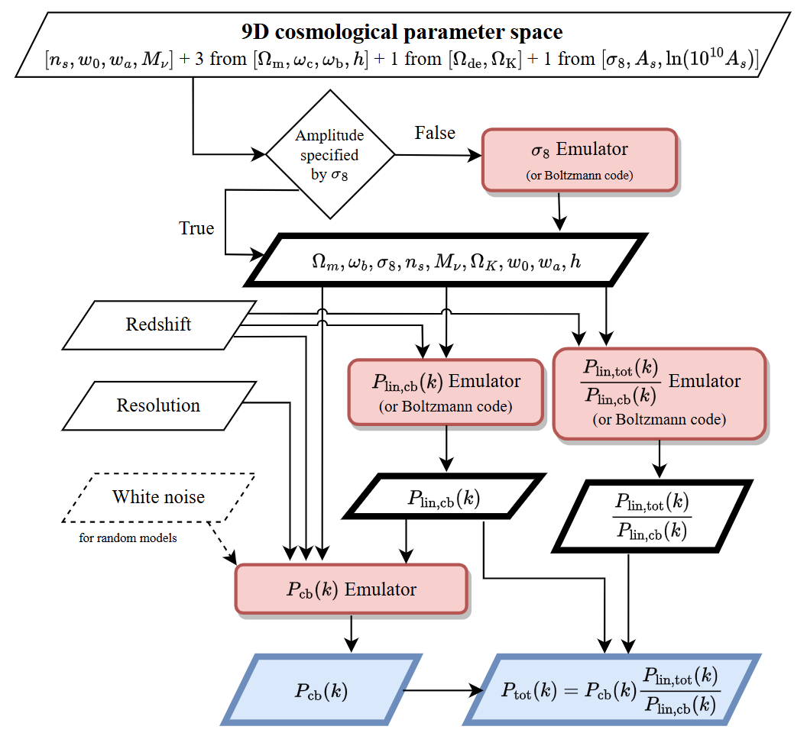

<link rel="stylesheet" href="./site.css">
<nav class="language-switch" aria-label="言語切り替え">
  <a href="./index.html" lang="ja" hreflang="ja" aria-label="日本語" aria-current="page">JA</a>
  <a href="./index_en.html" lang="en" hreflang="en" aria-label="English">EN</a>
</nav>

# Satoshi Tanaka's HP

## 研究内容

### 宇宙物理学

富岳などのスーパーコンピュータを用いた数値シミュレーションで、宇宙の大規模構造が形成される過程を調べています。特に、ニュートリノが構造形成に及ぼす影響を精密に計算しています。宇宙論パラメータの推定を効率化するため、シミュレーションデータから学習し、異なる条件での計算結果を高速に予測するエミュレータも開発しています。

  

    
<strong>富岳全系を使ったシミュレーション</strong>

    <iframe title="富岳全系を使ったシミュレーション" width="480" height="300" src="https://www.youtube.com/embed/Hwy11sb31S0?rel=0" frameborder="0" allow="accelerometer; autoplay; clipboard-write; encrypted-media; gyroscope; picture-in-picture" allowfullscreen></iframe>
  

  

    
<strong>DarkEmulator2</strong>

    
  

### データ駆動理学、解釈可能AI

データから学習したモデルは、なぜ物理現象を再現できるのか。ニューラルネットワークなどを対象に、その仕組みを数理的に調べています。

- キーワード : 宇宙物理学、宇宙論、大規模構造形成、ニュートリノ、Vlasovシミュレーション、高性能計算、機械学習、エミュレータ、ビッグデータ、 データ駆動理学、解釈可能AI

---

## プロフィール

- 2026.10-現職 一橋大学, 情報基盤センター, 講師
- 2025.4-2026.9 一橋大学, ソーシャル・データサイエンス研究科, 特任助教
- 2020.4-2025.3 京都大学, 基礎物理学研究所 極限構造研究部門, 特定研究員
- 2016.4-2020.3 筑波大学, 計算科学研究センター, 研究員
- 2015.4-2016.3 東京大学, 大学院理学系研究科, 特任研究員

- 2015.3 筑波大学, 数理物質科学研究科, 物理学専攻 博士後期課程 修了, 博士(物理学)
- 2010.3 筑波大学, 第一学群自然学類, 物理学専攻 卒業
- 2006.3 広島市立 基町高等学校 卒業

### 研究

- [researchmap](<https://researchmap.jp/satoshi.tanaka>)
- [Google Scholar](<https://scholar.google.com/citations?user=kd44lfUAAAAJ&hl=ja>)

---

## オープンソース

- [GitHub](<https://github.com/stanaka2>)
- [GitHub Gist](<https://gist.github.com/stanaka2>) : 主に計算機周りのメモ, プログラミングtips
- [MPI-Rockstar](<https://github.com/Tomoaki-Ishiyama/mpi-rockstar>) : Tomoyuki Tokuue, Tomoaki Ishiyama, Ken Osato, Satoshi Tanaka, and Peter Behroozi, 2024

---

## プロジェクト

- [Dark Quest Project](<https://darkquestcosmology.github.io/>)
- [シミュレーションとAIの融合で解明する宇宙の構造と進化](<https://www2.ccs.tsukuba.ac.jp/aiuniverse/>)
- 次世代宇宙論サーベイ群のための多波長宇宙論的シミュレーション
- [ダークマターの正体は何か？](<https://member.ipmu.jp/DarkMatter/>)
- [ポスト「京」重点課題⑨ 宇宙の基本法則と進化の解明](https://www.jicfus.jp/postk9/jp/)

---

## リンク

- [一橋大学 情報基盤センター](<https://www.hit-u.ac.jp/ictc/>)
- [京都大学 基礎物理学研究所](<https://www.yukawa.kyoto-u.ac.jp/>)
- [東京大学 宇宙理論研究室](<https://www-utap.phys.s.u-tokyo.ac.jp/>)
- [筑波大学 宇宙理論研究室](<https://www2.ccs.tsukuba.ac.jp/Astro/home/ja/>)

## 連絡先

- E-mail
  - satoshi.tanaka_AT_r.hit-u.ac.jp
_AT_は@に変換

- アドレス
  - 〒186-8601 東京都国立市中2-1 一橋大学 (第2研究館 631)
