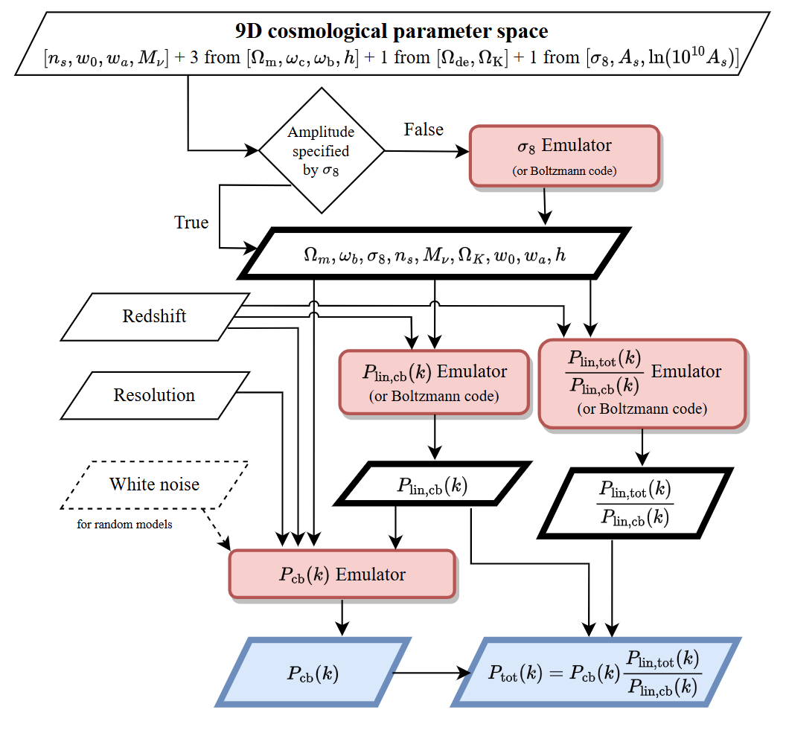

<link rel="stylesheet" href="./site.css">
<nav class="language-switch" aria-label="Language">
  <a href="./index.html" lang="ja" hreflang="ja" aria-label="日本語">JA</a>
  <a href="./index_en.html" lang="en" hreflang="en" aria-label="English" aria-current="page">EN</a>
</nav>

# Satoshi Tanaka's HP

## Research

- Keywords : Astrophysics, Cosmology, Large-scale Structure formation, neutrinos, Vlasov simulation, High-Performance Computing, Machine Learning, Emulators, Data Driven Science, Explainable AI

### Cosmology

I use supercomputers such as Fugaku to simulate how large-scale structure forms in the universe, with a particular focus on accurately modeling the effects of neutrinos. To speed up cosmological parameter inference, I also develop emulators that learn from simulation data and rapidly predict results for different parameter values.

  

    
<strong>Simulation on the full Fugaku system</strong>

    <iframe title="Simulation on the full Fugaku system" width="480" height="300" src="https://www.youtube.com/embed/Hwy11sb31S0?rel=0" frameborder="0" allow="accelerometer; autoplay; clipboard-write; encrypted-media; gyroscope; picture-in-picture" allowfullscreen></iframe>
  

  

    
<strong>DarkEmulator2</strong>

    
  

### Data Driven Science

Why can models trained on data reproduce physical phenomena? I use mathematical methods to study how neural networks and other machine learning models achieve this.

## Profile

- Oct 2026 – Present: Hitotsubashi University, Center for Information and Communication Technology, Assistant Professor
- Apr 2025 – Sep 2026: Hitotsubashi University, Graduate School of Social Data Science, Project Assistant Professor
- Apr 2020 – Mar 2025: Kyoto University, Yukawa Institute for Theoretical Physics, Researcher
- Apr 2016 – Mar 2020: University of Tsukuba, Center for Computational Science, Researcher
- Apr 2015 – Mar 2016: University of Tokyo, Graduate School of Science, Researcher

- Mar 2015: University of Tsukuba, Graduate School of Mathematical and Physical Sciences, Department of Physics – Ph.D. in Physics

### Research

- [researchmap](<https://researchmap.jp/satoshi.tanaka?lang=en>)
- [Google Scholar](<https://scholar.google.com/citations?user=kd44lfUAAAAJ&hl=en>)

---

## Open source

- [GitHub](<https://github.com/stanaka2>)
- [GitHub Gist](<https://gist.github.com/stanaka2>)
- [MPI-Rockstar](<https://github.com/Tomoaki-Ishiyama/mpi-rockstar>) : Tomoyuki Tokuue, Tomoaki Ishiyama, Ken Osato, Satoshi Tanaka, and Peter Behroozi, 2024

## Link

- [Hitotsubashi University, Center for Information and Communication Technology](<https://www.hit-u.ac.jp/ictc/>)
- [Kyoto University, Yukawa Institute for Theoretical Physics](<https://www.yukawa.kyoto-u.ac.jp/en-GB/>)
- [The University of Tokyo, Theoretical Astrophysics Group](<https://www-utap.phys.s.u-tokyo.ac.jp/>)
- [University of Tsukuba, Theoretical Astrophysics Group](<https://www2.ccs.tsukuba.ac.jp/Astro/home/en/>)
